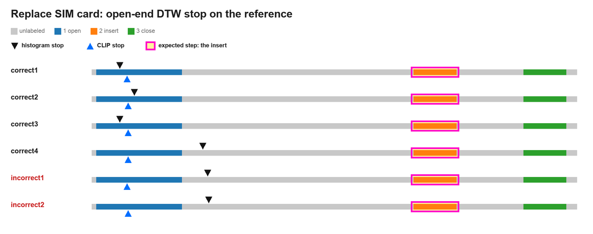
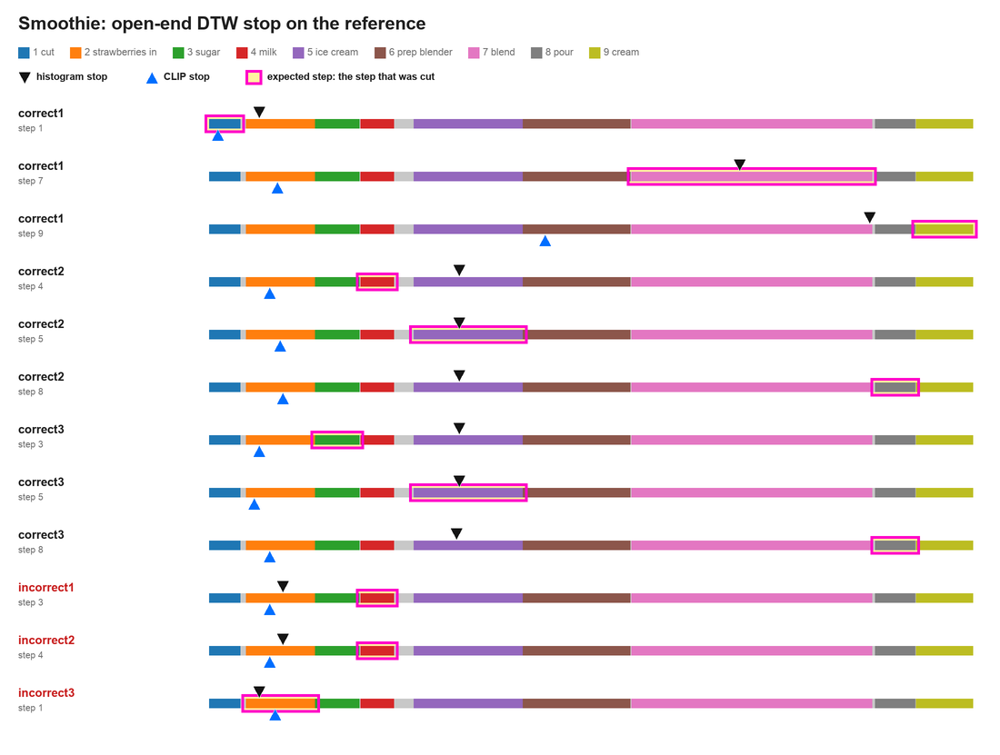
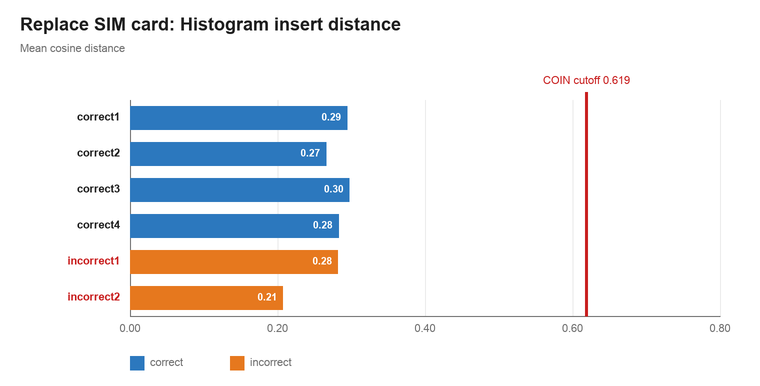
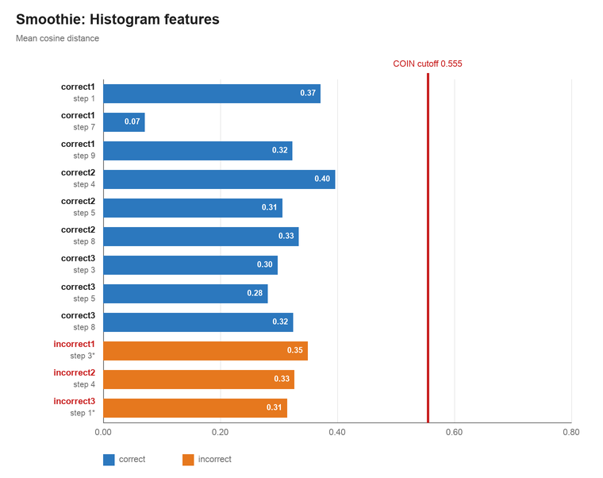
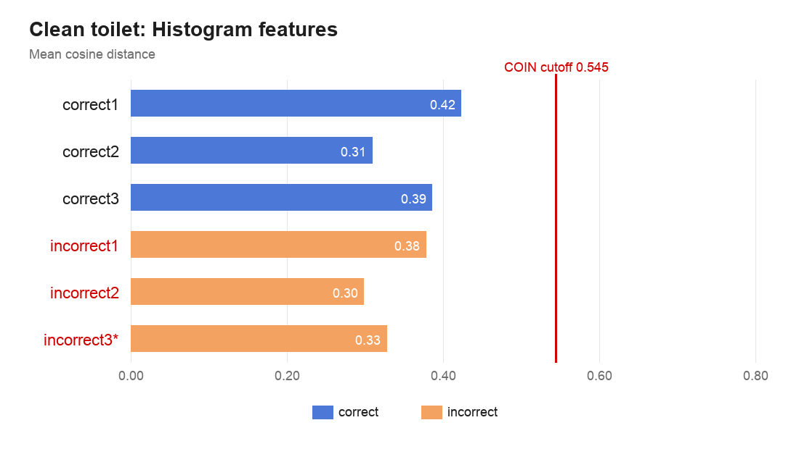
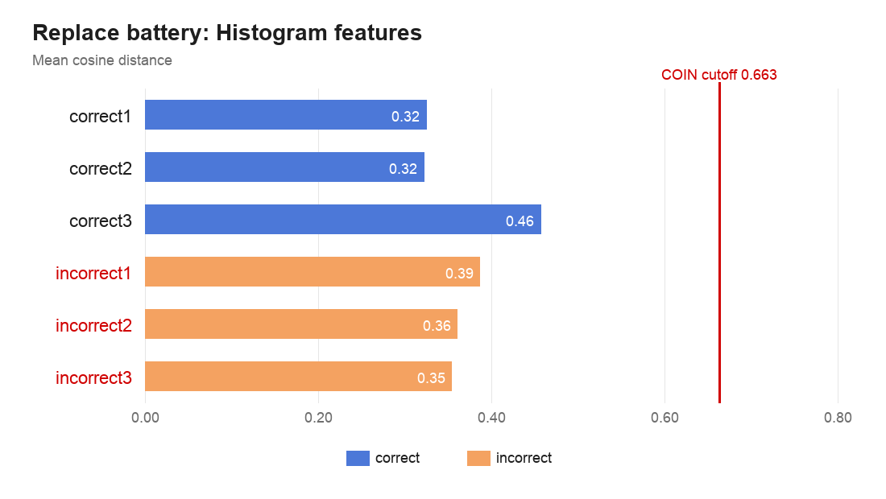
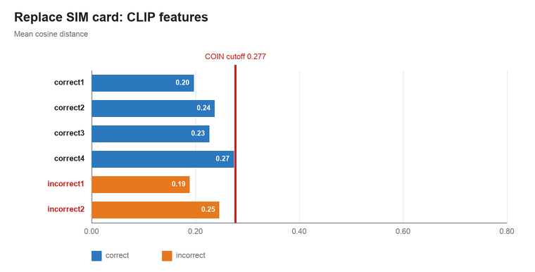
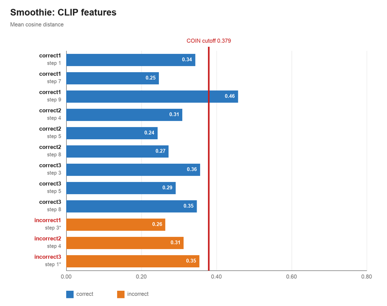
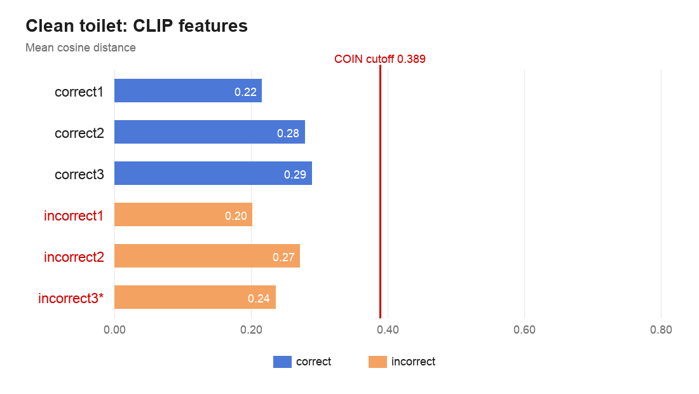
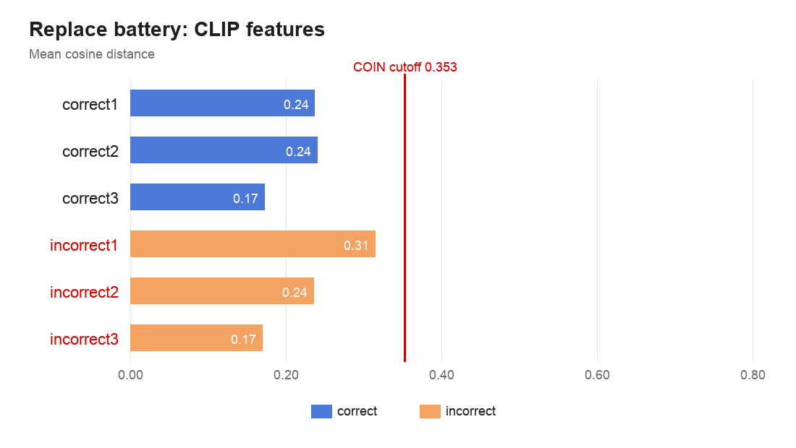

# No-ML and ML baselines

Four tasks: Replace SIM card, Strawberry smoothie, Clean toilet, and Replace battery. Phone recordings are cut in the middle of a step and compared with a reference video. Histogram features are the no-ML baseline and CLIP ViT-B/32 is the matching ML baseline. Both use DTW on cosine distance. A step is a deviation when its mean cosine distance is above the cutoff.

Recording names: Replace SIM card has correct1 to correct4 and incorrect1 to incorrect2, where the SIM is inserted wrongly. Smoothie has correct1 to correct3, and incorrect1 (sugar skipped), incorrect2 (chocolate milk instead of milk) and incorrect3 (strawberries not cut). Clean toilet has correct1 to correct3, incorrect1 (water spray instead of detergent), incorrect2 (shaving cream instead of detergent) and incorrect3 (detergent skipped). Replace battery has correct1 to correct3, incorrect1 and incorrect2 (battery inserted the wrong way) and incorrect3 (only one cell).

## Cutoffs

The cutoff is the mean plus two standard deviations of the mean cosine distance along the global DTW path, over all pairs of COIN videos that share one step list. Replace SIM card uses 48 COIN videos (1,128 pairs), Smoothie 17 (136 pairs), Clean toilet 3 (3 pairs) and Replace battery 13 (78 pairs). Every task uses the whole-video cutoff, taken over the full DTW path rather than per step. The toilet cutoff is weak because only three videos match.

| Task             | Histogram     | Cutoff | CLIP          | Cutoff |
| ---------------- | ------------- | ------ | ------------- | ------ |
| Replace SIM card | 0.413 ± 0.103 | 0.619  | 0.200 ± 0.039 | 0.277  |
| Smoothie         | 0.362 ± 0.096 | 0.555  | 0.294 ± 0.043 | 0.379  |
| Clean toilet     | 0.467 ± 0.039 | 0.545  | 0.278 ± 0.055 | 0.389  |
| Replace battery  | 0.442 ± 0.111 | 0.663  | 0.269 ± 0.043 | 0.353  |

## Open-end DTW

Open-end DTW places every frame of the crop onto the reference and stops at the reference frame with the lowest accumulated cost. A correct mapping stops inside the expected step, boxed in magenta. The black triangle is the histogram stop and the blue triangle is the CLIP stop.

### Replace SIM card

Every recording is cut in the middle of the insert and mapped onto the first reference.

No stop reaches the insert, for either feature.

### Smoothie

Each incorrect recording is tested on its mistake. A skipped step has no frames, so that recording is cut in the middle of the next step. Each correct recording is tested on three steps drawn at random with seed 0.

Histogram stops in the expected step for 4 of 12 cuts and CLIP for 2 of 12. CLIP stops around step 2 for most cuts, and histogram around step 5.

### Clean toilet

Every recording is cut in the middle of applying detergent and mapped onto `d2gMl6jwEEc`. Incorrect3 skips that step, so its crop ends in the middle of the scrub.

Histogram stops in the cut step for 4 of 6 crops. CLIP stops there for 5 of 6. Every open-end distance is under its cutoff, 0.545 for histogram and 0.389 for CLIP, so none is a deviation.

### Replace battery

Every recording is cut in the middle of putting the battery in and mapped onto `ROGBQhc9tCs`.

No path reaches that step for either feature. Histogram stops in step 1 or 2. CLIP does the same. The tested step has no open-end distance, so open-end DTW reports no deviation.

## Segment DTW

Segment DTW uses the annotated step boundaries. The recording frames of the step being done at the cut, up to the cut, are aligned with the whole reference step. Replace SIM card uses the first reference only. A star marks a skipped step, where the step done instead is compared with the reference's skipped step.

### Histogram

On Clean toilet and Replace battery, every bar is under the cutoff. The star on toilet incorrect3 is the skipped detergent step: the scrub that was underway is compared with the reference's detergent step.

### CLIP

### Result

Neither histogram nor CLIP catches a mistake on any of the four tasks, with open-end or segment DTW. Recall and precision are 0%. The only bar above a cutoff is CLIP on Smoothie correct1 step 9, a false positive.

<table>
<tr><th rowspan="2">Task</th><th colspan="2">Precision</th><th colspan="2">Recall</th></tr>
<tr><th>Histogram (no-ML)</th><th>CLIP (ML)</th><th>Histogram (no-ML)</th><th>CLIP (ML)</th></tr>
<tr><td>Replace SIM card</td><td>0%</td><td>0%</td><td>0%</td><td>0%</td></tr>
<tr><td>Smoothie</td><td>0%</td><td>0%</td><td>0%</td><td>0%</td></tr>
<tr><td>Clean toilet</td><td>0%</td><td>0%</td><td>0%</td><td>0%</td></tr>
<tr><td>Replace battery</td><td>0%</td><td>0%</td><td>0%</td><td>0%</td></tr>
</table>

## Zero-shot models at 2 fps

Gemini 3.5 Flash-Lite, GLM 5.3 Flash, and Muse Spark each see the reference, the phone crop, and the checklist, with no examples. The frame rate is 2 fps and the temperature is each model's default. Perform CPR is included. A mistake is caught when the tested step is marked a deviation. On the CPR recording that misses the pulse and presses the stomach, a flag on either of those steps counts. A call that returns no usable answer is not a catch.

| Task | Gemini | GLM | Muse | Gemini few-shot | GLM few-shot | Muse few-shot |
| --- | --- | --- | --- | --- | --- | --- |
| Replace SIM card | 0% | 0% | 0% | 50% | 50% | 0% |
| Smoothie | 66.7% | 33.3% | 33.3% | 100% | 66.7% | 33.3% |
| Clean toilet | 33.3% | 0% | 33.3% | 66.7% | 33.3% | 33.3% |
| Replace battery | 0% | 0% | 0% | 0% | 0% | 0% |
| Perform CPR | 0% | 0% | 33.3% | 0% | 0% | 0% |
| All 36 cuts | 21.4% | 7.1% | 21.4% | 42.9% | 28.6% | 14.3% |

The last row counts each incorrect cut once. Three correct smoothie recordings are cut three times, and those cuts are not mistakes, so they are not in the recall count. Every incorrect recording has one cut, so recall is hits out of those 14 cuts. An average of the five task percentages would be 20% for Gemini and Muse and 6.7% for GLM.

None of the three models catches either wrong SIM insertion. Gemini flags correct2. Gemini catches the skipped sugar and the uncut strawberries, and misses the chocolate milk. GLM and Muse catch only the chocolate milk. Gemini and Muse each catch one toilet mistake, the skipped detergent and the shaving cream. Muse also catches the stomach press in CPR and flags battery correct3. GLM catches nothing outside that one smoothie. Gemini has three calls with no answer, and GLM has two.

Few-shot uses the same frame rate and temperature, with the other tasks' steps and mistakes added as text. Gemini few-shot catches one wrong SIM insertion, all three smoothie mistakes, and two toilet mistakes. GLM few-shot catches one wrong SIM insertion, the uncut strawberries and the chocolate milk, and the skipped detergent. Muse few-shot catches the chocolate milk and the shaving cream, and misses the CPR stomach press it caught with no examples. Gemini few-shot has three calls with no usable answer, all on correct recordings, and GLM few-shot has two. Those count as misses only when the recording is incorrect.

## Average time saved

Task time runs from the start of the first annotated step to the end of the last. Replace SIM card incorrect times are the recorded times, including the repair. A wrong smoothie cannot be repaired, so its time is the time already spent at the cut plus one average correct run. Time saved is the average incorrect time minus the average correct time, as a share of the average incorrect time.

| Task             | Average correct | Average incorrect | Time saved |
| ---------------- | --------------- | ----------------- | ---------- |
| Replace SIM card | 27.5 s          | 52.7 s            | 47.7%      |
| Smoothie         | 103.1 s         | 128.0 s           | 19.5%      |
| Clean toilet     | 52.2 s          | 39.8 s            | 0%         |
| Replace battery  | 20.2 s          | 20.1 s            | 0%         |

Clean toilet and Replace battery use the recorded span from the first step to the last, as Replace SIM card does. The incorrect toilet recordings are shorter than the correct ones, mostly because the skipped-detergent video is 18 s, and the battery recordings are about the same length either way. A negative share is shown as 0.

For a model, the unassisted time is the average incorrect recording plus the average correct recording: the attempt goes wrong, and the task is then done again from the start. If the model catches the mistake, the assisted time is the time from the first annotated step to the cut, plus that model's average response time on the task, plus one average correct run. Those response times are 42.1 s, 37.8 s, 21.1 s, 50.7 s, and 74.9 s for Gemini, 35.4 s, 35.6 s, 15.1 s, 21.8 s, and 36.5 s for GLM, and 11.2 s, 12.0 s, 7.8 s, 8.9 s, and 11.7 s for Muse, in the order of the rows below. Gemini's CPR average leaves out two server errors that returned no time. A miss keeps the unassisted time. Time saved is the unassisted time minus the assisted time, as a share of the unassisted time, averaged over the incorrect recordings. A negative share is shown as 0. Muse's CPR catch is one of those, because the wait is longer than the time left in that short recording. Few-shot uses each model's own average response time on that task: 26.6 s, 35.0 s, 13.9 s, 15.3 s, and 25.1 s for Gemini, 38.8 s, 48.4 s, 19.2 s, 20.7 s, and 29.3 s for GLM, and 9.4 s, 12.2 s, 5.9 s, 6.7 s, and 13.2 s for Muse. Gemini's CPR average leaves out two timeouts. Gemini's and GLM's caught SIM insertions are shown as 0, because the wait is longer than the time left in that recording.

| Task | Gemini | GLM | Muse | Gemini few-shot | GLM few-shot | Muse few-shot |
| --- | --- | --- | --- | --- | --- | --- |
| Replace SIM card | 0% | 0% | 0% | 0% | 0% | 0% |
| Smoothie | 14.7% | 2.9% | 6.8% | 18.6% | 8.6% | 6.8% |
| Clean toilet | 4.8% | 0% | 8.7% | 14.0% | 5.5% | 9.4% |
| Replace battery | 0% | 0% | 0% | 0% | 0% | 0% |
| Perform CPR | 0% | 0% | 0% | 0% | 0% | 0% |
| All incorrect recordings | 4.2% | 0.6% | 3.3% | 7.0% | 3.0% | 3.5% |

## Latency and inference cost

Latency is the time from sending the request to receiving the answer. Inference cost is the published token price for that call: input tokens times the input rate, plus output tokens times the output rate. GLM and Muse output tokens include their thinking tokens. The rates are Gemini 3.5 Flash-Lite at $0.30 per million input tokens and $2.50 per million output tokens, GLM 5.3 Flash on a Modal shared endpoint at $0.45 and $1.50, and Muse Spark on a Modal shared endpoint at $1.25 and $4.25. The average is over the calls that returned a response. Gemini’s two server errors have no time and no token count, so they are left out. The other 34 Gemini calls are included, including the one answer that failed the JSON check.

| Model | Setting | Average latency | Average inference cost |
| --- | --- | --- | --- |
| Gemini 3.5 Flash-Lite | Zero-shot | 42.3 s | $0.016 |
| GLM 5.3 Flash | Zero-shot | 30.0 s | $0.032 |
| Muse Spark | Zero-shot | 10.6 s | $0.081 |
| Gemini 3.5 Flash-Lite | Few-shot | 25.2 s | $0.016 |
| GLM 5.3 Flash | Few-shot | 34.1 s | $0.034 |
| Muse Spark | Few-shot | 9.9 s | $0.082 |

